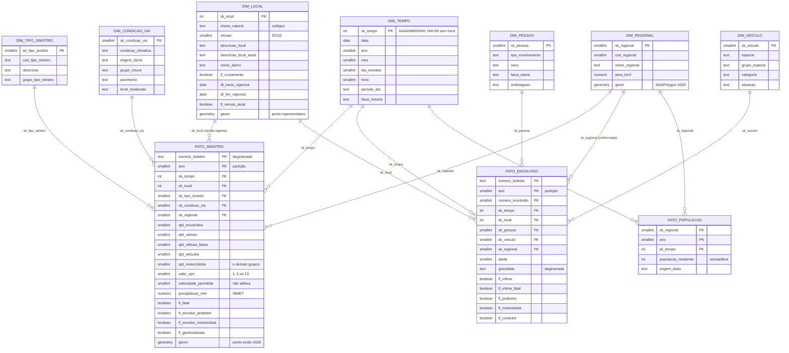

# Modelo dimensional do DW de sinistros de trânsito de BH

Modelo estrela com **3 fatos** e **7 dimensões** (nomes da Fase 2), schema `dw` do banco `dw_sinistros_bh`.
Este arquivo é gerado por `python -m etl.evidencias` a partir dos comentários do banco (`COMMENT ON`).

## Diagrama

Correção em relação ao diagrama da Fase 2: `DIM_PESSOA` e `DIM_VEICULO` ligam-se à `FATO_ENVOLVIDO` (grão: pessoa), e não à `FATO_SINISTRO` (grão: boletim). A `FATO_SINISTRO` responde ao perfil de veículos por local com contagens por espécie. A `DIM_REGIONAL` é conformada entre as três fatos.

Membros especiais em todas as dimensões: `-1` = Não informado, `-2` = Não se aplica.

## Dicionário de dados

### dw.dim_condicao_via (dimensão)

Dimensão lixo (junk) com as condições do local: clima (declarado no boletim ou imputado pelo INMET), pavimento e sinalização.

| coluna | tipo | aceita nulo | descrição |
|---|---|---|---|
| sk_condicao_via | smallint | não | Chave substituta (-1 = não informado, -2 = não se aplica). |
| cod_tempo | smallint | sim | Código do tempo declarado no boletim. |
| condicao_climatica | text | não | BOM, CHUVA, NEBLINA, NUBLADO (declarados), CHUVA (INMET), SEM CHUVA (INMET) ou NÃO INFORMADO. |
| origem_clima | text | não | DECLARADO NO BOLETIM, IMPUTADO PELO INMET ou NÃO INFORMADO. |
| grupo_chuva | text | não | Agrupamento comparável entre declarado e imputado: COM CHUVA, SEM CHUVA ou NÃO INFORMADO. |
| cod_pavimento | smallint | sim | Código do pavimento. |
| pavimento | text | não | Pavimento. |
| local_sinalizado | text | não | SIM, NÃO ou NÃO INFORMADO. |
| dt_carga | timestamp with time zone | não | Linhagem: data e hora da carga. |
| arquivo_origem | text | não | Linhagem: arquivo de origem. |

### dw.dim_local (dimensão)

Dimensão local de ocorrência (SCD Tipo 2): logradouro principal + logradouro de cruzamento (quando houver) + bairro. Nova versão quando o nome de um logradouro muda; o nome atual fica em todas as versões.

| coluna | tipo | aceita nulo | descrição |
|---|---|---|---|
| sk_local | integer | não | Chave substituta (-1 = não informado, -2 = não se aplica). |
| chave_natural | text | não | Chave natural pelos códigos: logradouro(s) e bairro (par de logradouros ordenado nos cruzamentos). |
| versao | smallint | não | Número da versão do local. |
| cod_logradouro_principal | integer | sim | Código do logradouro principal (cadastro da PBH). |
| tipo_logradouro_principal | text | sim | Tipo do logradouro principal (RUA, AVENIDA...). |
| nome_logradouro_principal | text | não | Nome do logradouro principal vigente na versão. |
| nome_anterior_principal | text | sim | Nome anterior do logradouro principal (versão anterior). |
| nome_logradouro_principal_atual | text | não | Nome atual do logradouro principal (igual em todas as versões). |
| cod_logradouro_cruzamento | integer | sim | Código do logradouro de cruzamento (nulo se não houver). |
| tipo_logradouro_cruzamento | text | sim | Tipo do logradouro de cruzamento. |
| nome_logradouro_cruzamento | text | sim | Nome do logradouro de cruzamento vigente na versão. |
| nome_anterior_cruzamento | text | sim | Nome anterior do logradouro de cruzamento. |
| nome_logradouro_cruzamento_atual | text | sim | Nome atual do logradouro de cruzamento. |
| cod_bairro | integer | sim | Código do bairro (0 = não informado). |
| nome_bairro | text | não | Nome do bairro (mais recente, normalizado). |
| fl_cruzamento | boolean | não | Verdadeiro se o local é um cruzamento. |
| descricao_local | text | não | Descrição legível na versão (ex.: "AVE AMAZONAS x RUA DOS TUPIS"). |
| descricao_local_atual | text | não | Descrição com os nomes atuais, para rankings históricos estáveis. |
| latitude | double precision | sim | Latitude do ponto representativo. |
| longitude | double precision | sim | Longitude do ponto representativo. |
| geom | geometry(Point,4326) | sim | Ponto representativo dos sinistros do local (o sinistro geolocalizado mais próximo do centroide), EPSG:4326. |
| qtd_pontos_geom | integer | sim | Quantidade de sinistros geolocalizados usados no ponto representativo. |
| dt_inicio_vigencia | date | não | Início da vigência da versão. |
| dt_fim_vigencia | date | não | Fim da vigência (exclusivo; 9999-12-31 na versão atual). |
| fl_versao_atual | boolean | não | Verdadeiro na versão vigente. |
| motivo_versao | text | sim | Motivo da abertura da versão. |
| dt_carga | timestamp with time zone | não | Linhagem: data e hora da carga. |
| arquivo_origem | text | não | Linhagem: arquivo(s) de origem. |

### dw.dim_pessoa (dimensão)

Dimensão perfil de pessoa envolvida (tipo de envolvimento x sexo x faixa etária x embriaguez). O cinto de segurança ficou de fora: o domínio alterna entre anos (valor padrão do sistema), ver README.

| coluna | tipo | aceita nulo | descrição |
|---|---|---|---|
| sk_pessoa | smallint | não | Chave substituta (-1 = não informado, -2 = não se aplica). |
| tipo_envolvimento | text | não | CONDUTOR, PASSAGEIRO, PEDESTRE ou NÃO INFORMADO. |
| sexo | text | não | MASCULINO, FEMININO ou NÃO INFORMADO. |
| faixa_etaria | text | não | Faixa etária (0 a 9 ... 70 ou mais, Não informada). |
| ordem_faixa_etaria | smallint | não | Ordem de exibição da faixa etária. |
| embriaguez | text | não | Indício de embriaguez: SIM, NÃO ou NÃO INFORMADO (consistente a partir de 2016). |
| dt_carga | timestamp with time zone | não | Linhagem: data e hora da carga. |
| arquivo_origem | text | não | Linhagem: origem da linha. |

### dw.dim_regional (dimensão)

Dimensão regional administrativa: as 9 regionais vigentes até jan/2025 (compatíveis com a série de sinistros e com o Censo 2022).

| coluna | tipo | aceita nulo | descrição |
|---|---|---|---|
| sk_regional | smallint | não | Chave substituta (-1 = não informada, -2 = não se aplica). |
| cod_regional | smallint | sim | Código da regional na PBH (COD_REG = cod_regional do si-bol, 18 a 26). |
| nome_regional | text | não | Nome da regional. |
| sigla | text | sim | Sigla da regional. |
| area_km2 | numeric(10,3) | sim | Área em km² (do arquivo da PBH). |
| perimetro_m | numeric(12,3) | sim | Perímetro em metros (do arquivo da PBH). |
| subdistritos_ibge | text | sim | Códigos dos subdistritos do IBGE que compõem a regional. |
| versao_limite | text | sim | Arquivo de limite de origem. |
| geom | geometry(MultiPolygon,4326) | sim | Polígono da regional (MultiPolygon, EPSG:4326). |
| dt_carga | timestamp with time zone | não | Linhagem: data e hora da carga. |
| arquivo_origem | text | não | Linhagem: arquivo de origem. |

### dw.dim_tempo (dimensão)

Dimensão tempo no grão data + hora (2010–2030). Membro "Sem hora" por dia (sk AAAAMMDD99) para boletins sem hora informada e para a fato_populacao; -1 e -2 são membros especiais.

| coluna | tipo | aceita nulo | descrição |
|---|---|---|---|
| sk_tempo | integer | não | Chave substituta inteligente AAAAMMDDHH (HH = 99 para "Sem hora"). |
| data | date | sim | Data. |
| ano | smallint | sim | Ano. |
| semestre | smallint | sim | Semestre (1–2). |
| trimestre | smallint | sim | Trimestre (1–4). |
| mes | smallint | sim | Mês (1–12). |
| nome_mes | text | não | Nome do mês em português. |
| ano_mes | text | sim | Ano e mês (AAAA-MM). |
| dia | smallint | sim | Dia do mês. |
| dia_semana | smallint | sim | Dia da semana ISO (1 = segunda ... 7 = domingo). |
| nome_dia_semana | text | não | Nome do dia da semana. |
| fl_fim_de_semana | boolean | sim | Sábado ou domingo. |
| hora | smallint | sim | Hora (0–23); nula no membro "Sem hora". |
| fl_hora_informada | boolean | não | Falso no membro "Sem hora" e nos membros especiais. |
| faixa_horaria | text | não | Faixa de 3 horas (00h–02h ... 21h–23h) ou "Hora não informada". |
| periodo_dia | text | não | Madrugada (0–5h), Manhã (6–11h), Tarde (12–17h), Noite (18–23h) ou "Hora não informada". |
| dt_carga | timestamp with time zone | não | Linhagem: data e hora da carga. |
| arquivo_origem | text | não | Linhagem: script que gerou a linha. |

### dw.dim_tipo_sinistro (dimensão)

Dimensão tipo de sinistro, com agrupamento derivado do domínio real (colisão/abalroamento, atropelamento, choque, capotamento/tombamento, queda, outros).

| coluna | tipo | aceita nulo | descrição |
|---|---|---|---|
| sk_tipo_sinistro | smallint | não | Chave substituta (-1 = não informado, -2 = não se aplica). |
| cod_tipo_sinistro | text | não | Código do tipo de sinistro (ex.: H06002). |
| descricao | text | não | Descrição padronizada. |
| descricao_origem | text | sim | Descrição como veio na fonte. |
| grupo_tipo_sinistro | text | não | Agrupamento analítico. |
| ordem | smallint | sim | Ordem de exibição. |
| dt_carga | timestamp with time zone | não | Linhagem: data e hora da carga. |
| arquivo_origem | text | não | Linhagem: arquivo de origem. |

### dw.dim_veiculo (dimensão)

Dimensão perfil de veículo (espécie x categoria x situação). Ligada à fato_envolvido: a pessoa herda o perfil do veículo quando o boletim tem exatamente um veículo da espécie dela.

| coluna | tipo | aceita nulo | descrição |
|---|---|---|---|
| sk_veiculo | smallint | não | Chave substituta (-1 = não identificado, -2 = não se aplica (pedestre)). |
| especie | text | não | Espécie do veículo. |
| grupo_especie | text | não | Grupo da espécie (Motocicleta, Automóvel/utilitário, Ônibus, Caminhão, Bicicleta, Outros). |
| categoria | text | não | Categoria (PARTICULAR, ALUGUEL...) ou NÃO IDENTIFICADA quando o veículo exato não pôde ser determinado. |
| situacao | text | não | Situação (EM MOVIMENTO, PARADO...) ou NÃO IDENTIFICADA. |
| fl_identificado | boolean | não | Verdadeiro se categoria e situação vêm do veículo identificado. |
| dt_carga | timestamp with time zone | não | Linhagem: data e hora da carga. |
| arquivo_origem | text | não | Linhagem: arquivo de origem. |

### dw.fato_envolvido (fato particionada por ano)

Fato envolvido: uma linha por pessoa envolvida (numero_boletim + ano + número do envolvido), particionada por ano. Recebe dim_pessoa e dim_veiculo, que não cabem no grão de boletim.

| coluna | tipo | aceita nulo | descrição |
|---|---|---|---|
| numero_boletim | text | não | Dimensão degenerada: número do boletim (o mesmo da fato_sinistro). |
| ano | smallint | não | Ano do sinistro (chave de partição). |
| numero_envolvido | smallint | não | Dimensão degenerada: número do envolvido no boletim. |
| sk_tempo | integer | não | FK dim_tempo. |
| sk_local | integer | não | FK dim_local (versão vigente na data). |
| sk_pessoa | smallint | não | FK dim_pessoa (perfil). |
| sk_veiculo | smallint | não | FK dim_veiculo (perfil herdado quando há exatamente um veículo da espécie da pessoa no boletim). |
| sk_regional | smallint | não | FK dim_regional (dimensão conformada com a fato_sinistro; acréscimo à Fase 2). |
| idade | smallint | sim | Idade em anos (atributo; nula se não informada). |
| gravidade | text | não | Dimensão degenerada: FATAL, NÃO FATAL, SEM FERIMENTOS ou NÃO INFORMADA. |
| qtd_envolvido | smallint | não | Contador (sempre 1) para somas. |
| fl_vitima | boolean | não | Vítima (gravidade NÃO FATAL ou FATAL); envolvido ileso não é vítima. |
| fl_vitima_fatal | boolean | não | Vítima fatal. |
| fl_pedestre | boolean | não | Pedestre. |
| fl_motociclista | boolean | não | Condutor ou passageiro de motocicleta (grupo). |
| fl_condutor | boolean | não | Condutor. |
| origem_tipo_envolvimento | text | não | INDICADOR DA FONTE ou REGRA DERIVADA (ver README). |
| origem_especie_veiculo | text | não | Origem da espécie do veículo da pessoa: INFORMADA NO BOLETIM, IMPUTADA (ESPÉCIE ÚNICA NO BOLETIM), NÃO INFORMADA ou NÃO SE APLICA (PEDESTRE). |
| dt_carga | timestamp with time zone | não | Linhagem: data e hora da carga. |
| arquivo_origem | text | não | Linhagem: arquivo si_env de origem. |

### dw.fato_populacao (fato)

Fato população residente por regional e ano (referência 1º de julho, membro "Sem hora" da dim_tempo). Denominador das taxas por 100 mil habitantes.

| coluna | tipo | aceita nulo | descrição |
|---|---|---|---|
| sk_regional | smallint | não | FK dim_regional. |
| sk_tempo | integer | não | FK dim_tempo: 1º de julho do ano, membro "Sem hora" (AAAA070199). |
| ano | smallint | não | Ano de referência. |
| populacao_residente | integer | não | População residente da regional (medida semiaditiva: soma entre regionais, não entre anos). |
| participacao_regional | numeric(12,10) | não | Participação da regional na população do município. |
| populacao_municipio | integer | não | População do município no ano (as regionais somam exatamente este total). |
| origem_dado | text | não | CENSO, ESTIMATIVA IBGE x PROPORÇÃO ou INTERPOLADO x PROPORÇÃO. |
| origem_total_municipio | text | não | Origem do total municipal (tabela SIDRA ou interpolação). |
| metodo_regional | text | não | Método da participação da regional (Censo 2022, Censo 2010 por setores ou interpolação linear 2010–2022). |
| dt_carga | timestamp with time zone | não | Linhagem: data e hora da carga. |
| arquivo_origem | text | não | Linhagem: arquivos de origem. |

### dw.fato_sinistro (fato particionada por ano)

Fato sinistro: uma linha por boletim de ocorrência (numero_boletim + ano), particionada por ano. Contagens de veículos por espécie respondem ao perfil da frota por local sem quebrar o grão.

| coluna | tipo | aceita nulo | descrição |
|---|---|---|---|
| numero_boletim | text | não | Dimensão degenerada: número do boletim (sufixo /n para eventos distintos com o mesmo número no ano). |
| ano | smallint | não | Ano do sinistro (chave de partição). |
| sk_tempo | integer | não | FK dim_tempo (data + hora; AAAAMMDD99 quando a hora não foi informada). |
| sk_local | integer | não | FK dim_local (versão vigente na data do sinistro). |
| sk_tipo_sinistro | smallint | não | FK dim_tipo_sinistro. |
| sk_condicao_via | smallint | não | FK dim_condicao_via. |
| sk_regional | smallint | não | FK dim_regional (código do boletim; 27 Hipercentro -> Centro-Sul; nulo/0 resolvido por ST_Within do ponto do boletim ou, sem ponto, do ponto representativo do local). |
| qtd_envolvidos | smallint | não | Pessoas envolvidas (si_env). |
| qtd_vitimas | smallint | não | Vítimas: envolvidos com severidade não fatal ou fatal. |
| qtd_vitimas_fatais | smallint | não | Vítimas fatais (severidade fatal no si_env). |
| qtd_veiculos | smallint | não | Veículos envolvidos (si-veic). |
| qtd_motocicletas | smallint | não | Veículos do grupo Motocicleta (motocicleta, motoneta, ciclomotor, triciclo). |
| qtd_automoveis | smallint | não | Veículos do grupo Automóvel/utilitário. |
| qtd_onibus | smallint | não | Veículos do grupo Ônibus (ônibus e micro-ônibus). |
| qtd_caminhoes | smallint | não | Veículos do grupo Caminhão (caminhão, caminhão-trator, reboque). |
| qtd_bicicletas | smallint | não | Bicicletas. |
| qtd_outros_veiculos | smallint | não | Demais espécies e não informadas. |
| valor_ups | smallint | não | Unidade Padrão de Severidade (1, 5 ou 13): a da fonte quando informada; senão 13 se houve morte e 5 caso contrário. |
| fl_ups_imputada | boolean | não | Verdadeiro quando a UPS não veio na fonte (0 a partir de 2016) e foi derivada da severidade. |
| velocidade_permitida | smallint | sim | Velocidade máxima permitida (km/h) — medida NÃO aditiva; nula se não informada. |
| precipitacao_mm | numeric(6,1) | sim | Precipitação do INMET na hora do sinistro (mm) — medida não aditiva entre sinistros. |
| estacao_inmet | text | sim | Estação usada para a precipitação (A521 Pampulha ou F501 Cercadinho). |
| fl_fatal | boolean | não | Verdadeiro se houve ao menos uma vítima fatal. |
| fl_envolve_pedestre | boolean | não | Verdadeiro se há pedestre envolvido ou o tipo é atropelamento de pessoa. |
| fl_envolve_motociclista | boolean | não | Verdadeiro se há motocicleta (grupo) entre os veículos ou envolvidos. |
| fl_geolocalizado | boolean | não | Verdadeiro se a coordenada é válida e está dentro do município. |
| latitude | double precision | sim | Latitude do ponto exato (WGS 84). |
| longitude | double precision | sim | Longitude do ponto exato (WGS 84). |
| geom | geometry(Point,4326) | sim | Ponto exato do sinistro (EPSG:4326), para o mapa de calor. |
| origem_regional | text | não | BOLETIM, HIPERCENTRO -> CENTRO-SUL, ESPACIAL (ST_Within), ESPACIAL (regional mais próxima), ESPACIAL (ponto do local) ou NÃO RESOLVIDA. |
| dt_carga | timestamp with time zone | não | Linhagem: data e hora da carga. |
| arquivo_origem | text | não | Linhagem: arquivo si-bol de origem. |

### dw.mv_indicadores_regional_ano (view materializada)

Sinistros, vítimas, mortos, UPS e taxas por 100 mil habitantes por regional e ano (risco ajustado pela população).

| coluna | tipo | aceita nulo | descrição |
|---|---|---|---|
| ano | smallint | sim | Ano. |
| sk_regional | smallint | sim | Chave da regional. |
| cod_regional | smallint | sim | Código da regional. |
| nome_regional | text | sim | Nome da regional. |
| sigla | text | sim | Sigla da regional. |
| sinistros | bigint | sim | Sinistros com vítima. |
| sinistros_fatais | bigint | sim | Sinistros com ao menos uma morte. |
| vitimas | bigint | sim | Vítimas. |
| mortos | bigint | sim | Vítimas fatais. |
| ups | bigint | sim | Soma da Unidade Padrão de Severidade. |
| populacao | integer | sim | População residente da regional no ano. |
| taxa_sinistros_100mil | numeric | sim | Sinistros por 100 mil habitantes. |
| taxa_vitimas_100mil | numeric | sim | Vítimas por 100 mil habitantes. |
| taxa_mortos_100mil | numeric | sim | Mortos por 100 mil habitantes. |

### dw.mv_participacao_vitimas_ano (view materializada)

Participação de pedestres e motociclistas (grupos prioritários) nas vítimas e nos mortos, por ano.

| coluna | tipo | aceita nulo | descrição |
|---|---|---|---|
| ano | smallint | sim | Ano. |
| vitimas | bigint | sim | Total de vítimas. |
| vitimas_pedestres | bigint | sim | Vítimas pedestres. |
| vitimas_motociclistas | bigint | sim | Vítimas motociclistas (condutores e passageiros). |
| pct_vitimas_pedestres | numeric | sim | Percentual de pedestres nas vítimas. |
| pct_vitimas_motociclistas | numeric | sim | Percentual de motociclistas nas vítimas. |
| mortos | bigint | sim | Total de mortos. |
| mortos_pedestres | bigint | sim | Mortos pedestres. |
| mortos_motociclistas | bigint | sim | Mortos motociclistas. |
| pct_mortos_pedestres | numeric | sim | Percentual de pedestres nos mortos. |
| pct_mortos_motociclistas | numeric | sim | Percentual de motociclistas nos mortos. |

### dw.mv_ranking_locais (view materializada)

Ranking de locais e cruzamentos por ano (sinistros, vítimas, mortos, UPS), agregando todas as versões do local pela chave natural e exibindo o nome atual.

| coluna | tipo | aceita nulo | descrição |
|---|---|---|---|
| chave_natural | text | sim | Chave natural do local. |
| ano | smallint | sim | Ano. |
| descricao_local_atual | text | sim | Descrição do local com os nomes atuais. |
| fl_cruzamento | boolean | sim | Verdadeiro se é cruzamento. |
| nome_bairro | text | sim | Bairro. |
| sinistros | bigint | sim | Sinistros com vítima. |
| vitimas | bigint | sim | Vítimas. |
| mortos | bigint | sim | Vítimas fatais. |
| ups | bigint | sim | Soma da UPS (severidade ponderada). |
| sinistros_com_pedestre | bigint | sim | Sinistros com pedestre envolvido. |
| sinistros_com_motocicleta | bigint | sim | Sinistros com motocicleta envolvida. |
| rank_ups_ano | bigint | sim | Posição no ano pela UPS. |
| rank_sinistros_ano | bigint | sim | Posição no ano pelo número de sinistros. |
| latitude | double precision | sim | Latitude do ponto representativo do local. |
| longitude | double precision | sim | Longitude do ponto representativo do local. |

### dw.mv_taxa_mortalidade_anual (view materializada)

Taxa anual de mortos no trânsito por 100 mil habitantes, meta municipal (50% da taxa de 2014 até 2030) e distância até a meta (nulas se 2014 não estiver carregado).

| coluna | tipo | aceita nulo | descrição |
|---|---|---|---|
| ano | smallint | sim | Ano. |
| populacao | bigint | sim | População do município (soma das regionais). |
| origem_populacao | text | sim | Origem do total populacional. |
| sinistros | bigint | sim | Sinistros com vítima. |
| vitimas | bigint | sim | Vítimas (feridos + mortos). |
| mortos | bigint | sim | Vítimas fatais registradas nos boletins. |
| taxa_mortos_100mil | numeric | sim | Mortos por 100 mil habitantes. |
| taxa_vitimas_100mil | numeric | sim | Vítimas por 100 mil habitantes. |
| taxa_base_2014 | numeric | sim | Taxa de mortos de 2014 (ano-base da meta). |
| meta_2030 | numeric | sim | Meta para 2030: 50% da taxa de 2014. |
| distancia_meta | numeric | sim | Taxa do ano menos a meta (positivo = acima da meta). |
| pct_reducao_vs_2014 | numeric | sim | Redução percentual da taxa em relação a 2014. |
